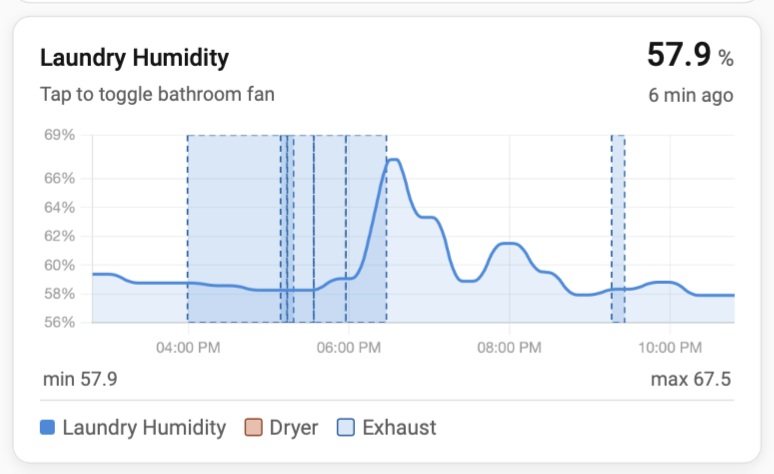

# Overlay Graph Card

Home Assistant Lovelace card that plots a sensor's history and shades background regions when one or more other entities are active (valve open, compressor running, door open, etc.).



## Features

- Line or bar graph of any numeric sensor's history
- Shaded overlays from any number of entities: binary sensors, switches, valves, covers, climate states, or numeric sensors above a threshold
- Optional min/max band and mean line from long-term statistics
- Adjustable smoothing, colours and opacity
- Visual editor, tap and hold actions
- Self-contained: no internet access needed at runtime

## Installation (HACS)

1. In HACS, open the menu (⋮) → **Custom repositories**.
2. Add `https://github.com/hdcoffeeboy/ha-overlay-graph-card`, type **Dashboard**.
3. Search for **Overlay Graph Card**, download it, and reload the browser.

HACS adds the dashboard resource automatically.

## Installation (manual)

1. Download `overlay-graph-card.js` from the latest [release](https://github.com/hdcoffeeboy/ha-overlay-graph-card/releases) (or build it, below) and copy it to `<config>/www/`.
2. Add a dashboard resource: URL `/local/overlay-graph-card.js`, type **JavaScript module**.

The card is self-contained (Chart.js is bundled); no internet access is needed at runtime.

## Configuration

The card has a visual editor (add it from the dashboard card picker). All options can also be set in YAML. Full example:

```yaml
type: custom:overlay-graph-card
entity: sensor.coolroom_temperature
name: Cool Room
secondary_info: "Compressor + door monitoring"  # optional label below name; hides entity ID when set
unit: "°C"
hours_to_show: 24
color: blue
graph: line
smoothing: 0.2

# Single overlay (object form – back-compatible)
# overlay:
#   entity: binary_sensor.coolroom_compressor
#   label: Compressor
#   color: amber
#   opacity: 0.35
#   invert: false      # true = highlight when OFF instead of ON
#   threshold: null    # numeric sensors: active above this value

# Multiple overlays (list form)
overlay:
  - entity: binary_sensor.coolroom_compressor
    label: Compressor running
    color: amber
    opacity: 0.35
    invert: false      # true = highlight when inactive instead
    # threshold: 0.1   # numeric sensors: active above this value
    # active_state: "running"             # single string state
    # active_state: ["heating","cooling"] # or a list of states
  - entity: binary_sensor.coolroom_door
    label: Door open
    color: coral
    opacity: 0.30
    invert: false

# Tap / hold actions
tap_action:
  action: more-info          # more-info | navigate | toggle | call-service | none
hold_action:
  action: call-service
  service: script.start_irrigation
  # service_data:
  #   duration: 300
  # navigation_path: /lovelace/irrigation  (for navigate action)
  # entity: switch.other_entity            (overrides card entity for toggle/more-info)

show:
  name: true
  icon: true
  entity_id: true
  current_value: true
  legend: true
  extremes: false
  statistics: false
  statistics_opacity: 0.18
```

### Card options

| Option | Default | Description |
|---|---|---|
| `entity` | **required** | Sensor to plot |
| `name` | friendly name | Card title |
| `icon` | entity icon | Card icon |
| `secondary_info` | entity ID | Subtitle under the name |
| `unit` | entity unit | Unit shown on value, axis and tooltip |
| `hours_to_show` | `24` | Time window in hours |
| `graph` | `line` | `line` or `bar` |
| `color` | `teal` | `teal`, `blue`, `amber`, `coral`, `purple`, `green`, `red` |
| `smoothing` | `true` | `false` = raw, `true` = 0.2, or a strength from 0 to 1 |
| `overlay` | – | One overlay object or a list (below) |
| `tap_action` | `more-info` | [Action](https://www.home-assistant.io/dashboards/actions/); `entity` overrides the card entity for toggle / more-info |
| `hold_action` | `none` | As `tap_action` |
| `show` | – | Display switches (below) |

### Overlay options

| Option | Default | Description |
|---|---|---|
| `entity` | **required** | Entity whose state drives the shading |
| `label` | `Active` | Legend and tooltip text |
| `color` | graph colour | A colour name, or `auto` to pick from the entity type |
| `opacity` | `0.35` | Shading opacity, 0–1 |
| `invert` | `false` | Shade while the entity is **not** active |
| `threshold` | – | Numeric entities: active when the value is above this |
| `active_state` | – | A state or list of states that count as active |

An overlay is active when its state is in `active_state` if set; otherwise above `threshold` if set; otherwise one of `on`, `open`, `unlocked`, `active`, `running`, `heating`, `cooling`, `fan_only`, `true`, `1`. `invert` is applied last.

### `show` options

| Option | Default | Description |
|---|---|---|
| `name` | `true` | Title |
| `icon` | `true` | Icon |
| `entity_id` | `true` | Entity ID under the title (hidden when `secondary_info` is set or `statistics` is on) |
| `current_value` | `true` | Current value and last-changed time |
| `legend` | `true` | Legend |
| `extremes` | `false` | Min and max values under the graph |
| `statistics` | `false` | Min/max band and mean line from long-term statistics (falls back to history if none) |
| `statistics_opacity` | `0.18` | Band opacity |

`tap_action` / `hold_action` use Home Assistant's standard [action configuration](https://www.home-assistant.io/dashboards/actions/) (`more-info`, `toggle`, `navigate`, `url`, `perform-action`, `none`). Legacy `call-service` still works.

## Development

Requires Node.js 20+.

```sh
npm install
npm run build   # → dist/overlay-graph-card.js
npm run watch   # rebuild on change
```

Source is in `src/`: `overlay-graph-card.js` (card), `editor.js` (visual editor), `const.js` (shared defaults). The version shown in the browser console comes from `package.json`.

### Releasing

1. Merge changes to `main`.
2. On GitHub, **Releases → Draft a new release**, tag `vX.Y.Z`, publish.
3. The Release workflow builds the card with that version and attaches `overlay-graph-card.js`, which HACS installs.
